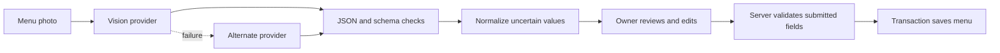

# Design decisions and tradeoffs

## Flow

Extraction and persistence are separate operations. A successful model response never directly writes menu rows. The UI scans photos separately, preserving per-photo progress and review. The scanner also supports multi-image merging, but that merge is not the same as the UI's per-photo workflow.

## Why these corrections matter

| Boundary | Former behavior | Current behavior |
|---|---|---|
| JSON | Some malformed brace-containing responses became empty results | Throw and try configured fallback |
| Dietary values | PHP string `"false"` could become true; missing could default true | Explicit true/false parsing; ambiguous becomes null |
| Price | Character stripping could turn a negative into a positive | Strict decimal syntax, range check, unresolved value becomes null |
| Saving | Client assumptions could leak into persisted flags | Required boolean server validation |
| Logo palette | Upper brightness exclusion discarded pure saturated red/blue | Saturation filtering retains bright chromatic colors |
| Logo storage | A false write result could be followed by changed settings | Check write; save settings; only then remove prior asset |

Schema validation bounds category, item and variant counts and checks list shapes. This is deliberately narrower than trusting a JSON-mode promise from a provider. It does not prove the content is factually correct.

OpenRouter retries once after a fixed delay for connection errors, HTTP 429 and 5xx. Permanent HTTP failures move to fallback directly. Mistral currently has a 30-second timeout and no equivalent retry. Multiple images can therefore accumulate substantial latency. A queued workflow and a whole-request time budget would be appropriate at higher volume.

The scanner tolerates JSON fences and surrounding text by taking the first-to-last object span. Multiple unrelated objects can make that span invalid, which invokes fallback. A stricter structured-output contract could reduce ambiguity, but local validation is still necessary.

Names are compared case-insensitively within a category and first occurrence wins during scanner merge. This can hide conflicting prices across photos. The review UI and server also have distinct duplicate rules; there is no claim of exactly-once concurrent imports. Database uniqueness, explicit conflict review and idempotency are future work.

Prices use floats in the extraction DTO and decimal-style validation. Integer minor units would be a better general money representation. The existing commit policy skips nonpositive/missing base prices and reports the count; it can also omit unusable variants. That policy should be made clearer before broader rollout. The scanner's prompt assumes rupees, and the synthetic admin screenshot shows a default dollar-format label: currency configuration needs end-to-end alignment.

Storage and database updates do not form one atomic transaction. Cleanup handles ordinary caught failures, but process termination can still leave an orphan file. A cleanup job/outbox strategy would address this. Logo tests cover failure semantics and selected colors, not perceptual brand accuracy across real customer assets.

## What this sample does not establish

No production reliability, broad multilingual OCR accuracy, measured time savings, user growth, cost-per-import guarantee, or production PostgreSQL behavior is claimed. Logs, authorization, tenancy isolation, CSRF, upload limits and deployment controls belong to the complete app and require their own audit.
