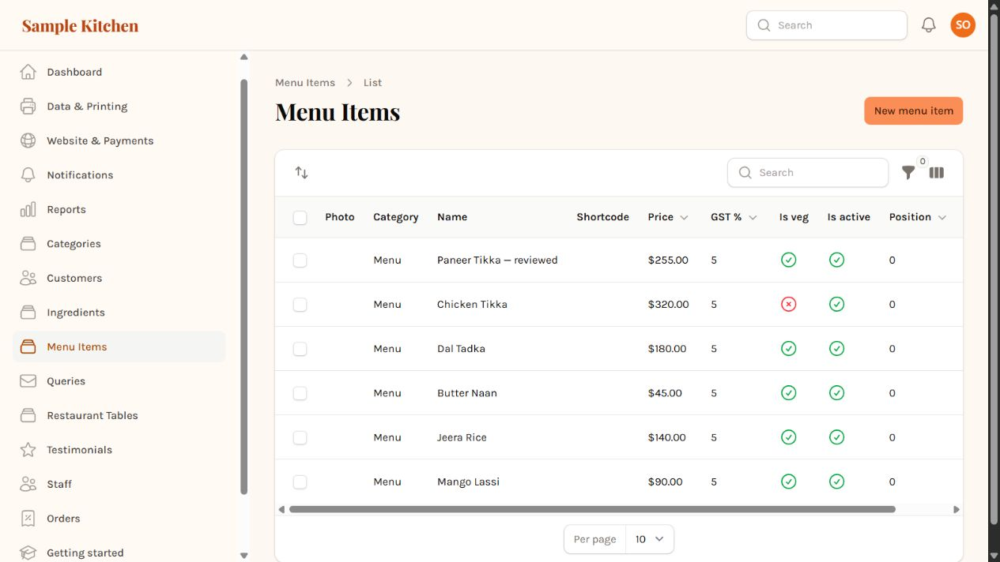

# Verification record

Prepared 2026-11-01. All browser/database work used a synthetic local tenant, not production.

## Standalone regression tests

`composer test`: **9 tests, 35 assertions passed** under PHP 8.4.24 / PHPUnit 12.5.42. Machine-readable record: `component-tests.xml`. Tests use mocked HTTP and prohibit stray requests. The suite covers invalid JSON/schema fallback, uncertain flags, invalid prices, valid empty output, retry on 429, permanent-error fallback, all-provider failure, first-match merging, absent configuration, and bright palette colors.

## Full application checks

Earlier focused application run: 35 tests, 34 passed, 139 assertions. The one failure was in a new filesystem test mock, not a demonstrated application failure. Replacing only the public disk fixed that test; targeted rerun passed with seven assertions. All 35 selected tests therefore passed across those runs, **not in one second complete run**. Selected classes: MenuScannerValidationTest, ColorExtractorPrimaryTest, ImportMenuTest, LogoAutoResizeTest, OnboardingTest.

Final React production build passed. PHP changes were syntax checked; initial fixes were formatted with Pint and JSX with Biome. No full repository test suite or production PostgreSQL run is claimed. Sample component dependency versions are independently locked; the full application keeps its existing lockfile.

## Live model evaluation

Provider: Mistral. Model: `pixtral-12b-2409`. Recorded UTC timestamps and raw normalized responses are in `evaluation/results/live-results.json`. The scorer compares whitespace/case-normalized dish names, base price, dietary flag, and sorted lists of variant name/price pairs. Category correctness is not scored. It reports missing/extra names and repeated normalized dish names. The scorer also rejects missing or repeated fixture runs. Four offline Python checks cover matching, duplicates, wrong prices, and missing items.

| Fixture | Expected / extracted | Field errors | Elapsed |
|---|---:|---:|---:|
| Clear | 6 / 6 | 0 | 8.507 s |
| Two-column | 8 / 8 | 0 | 6.233 s |
| Half/full portions | 4 / 4 | 0 | 5.616 s |
| Blurred | 6 / 6 | 0 | 4.351 s |

No missing or extra names were recorded. Eight portion variants matched. Clear and blurred share the same six dishes: 24 instances, 18 distinct dishes. These are generated, controlled English fixtures with printed dietary labels, not a random real-world dataset. Each fixture ran once; no latency percentile or accuracy confidence interval is justified. Cost was not measured. OpenRouter was tested with mocks, not a live credential.

## Browser save/reopen check

1. Logged into the isolated synthetic tenant and uploaded the clear fixture.
2. A real Mistral request extracted six dishes.
3. Set a dietary selection to unresolved and attempted import; the UI blocked it with the review message.
4. Restored the flag; changed the first dish to `Paneer Tikka — reviewed` and price to `255`.
5. Imported: success reported six dishes and one category.
6. Opened Menu Items and reloaded. Edited name and numeric price persisted.

The screenshot shows the local admin's default dollar formatting, while extraction assumes rupees. Numeric persistence passed; currency presentation is a known separate issue. Automatic dish-photo matching was not verified. No end-to-end browser logo-upload check was completed; that path has targeted framework tests.

No deployment or application submission was performed.
